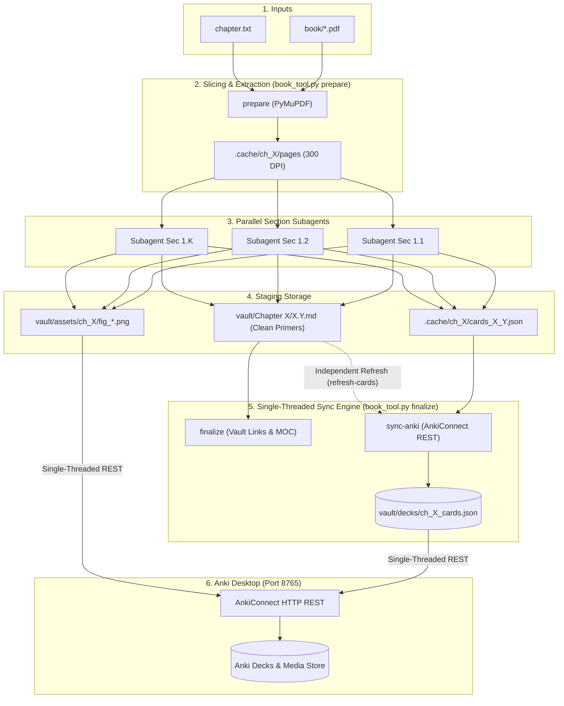

# Technical Specification: Book-Synthesizer with AnkiConnect

- **Status**: `FINAL — Red-Team Validated`
- **Last Updated**: 2026-10-20
- **Companion Audit Log**: [RED_TEAM_AUDIT.md](./RED_TEAM_AUDIT.md)

---

## 1. Overview & Core Problem
- **Problem Statement**: Dense engineering and mathematics textbooks pack heavy conceptual leaps, implicit assumptions, and multi-step derivations into each numbered section (`1.1`, `1.2`, `1.3`). The user needs a zero-friction, **Antigravity-native tool** that takes a textbook PDF and a target chapter number, and generates:
  1. A dedicated Obsidian **Pre-Reading Primer Note** for each numbered section (`X.1`, `X.2`, ...) preserving physical intuition, complete mathematical rigor (LaTeX), and cropped textbook diagrams.
  2. A comprehensive, high-yield set of **Anki Flashcards** for everything worth remembering in that section (definitions, core formulas, physical interpretations, diagram reading).
  3. Seamless two-way integration via **AnkiConnect** (`http://127.0.0.1:8765`) that enables updating, refining, or adding flashcards on demand without blowing away existing review schedules or card intervals.
  4. The ability to **refresh, add, or polish flashcards** (by section or chapter) independently, without having to re-synthesize the reading notes from scratch.
- **Architectural Philosophy**: **Strict Separation of Concerns**. Obsidian notes remain 100% clean, distraction-free reading primers. Flashcards live in Anki for active recall, managed through a structured local JSON ledger (`vault/decks/ch_XX_cards.json`).
- **Target User / Execution Surface**: Solo engineer/student operating inside **Antigravity** on local Windows, combining a local Python PDF/Vault/Anki CLI helper (`book_tool.py`) with Anki desktop via AnkiConnect HTTP API (`http://127.0.0.1:8765`).
- **Non-Goals**:
  - Embedding flashcard clutter inside reading notes (kept isolated in `vault/decks/`).
  - Hard-deleting cards automatically during routine re-synthesis (cards removed on re-synthesis are auto-suspended in Anki to preserve spaced repetition history; the user can manually reinsert or delete them).
  - Synthesizing non-content sections (*Bibliography*, *References*, *Problems*, *Exercises*, *Appendices*).

---

## 2. Core User Flows (The Happy Path)

1. **Flow 1 — End-to-End Synthesis & Initial Card Extraction**:
   - User drops PDF in `book/`, sets `chapter.txt` (e.g., `1`), and triggers `/synthesize`.
   - `book_tool.py prepare` extracts the chapter and section boundaries.
   - For each section `X.Y`:
     - Figures are cropped to `vault/assets/ch_XX/`.
     - Primer note is written to `vault/Chapter XX/X.Y <Title>.md`.
     - Section subagent extracts flashcards for all definitions, formulas, and diagrams into an isolated worker file `.cache/ch_XX/cards_X_Y.json` (eliminating concurrent file/API race conditions).
   - Single-threaded `book_tool.py finalize` aggregates cards into `vault/decks/ch_XX_cards.json` and syncs with Anki.
2. **Flow 2 — Independent Card Refresh (`book_tool.py refresh-cards`)**:
   - Without re-running the heavy PDF rendering or rewriting Obsidian primer notes, the user can say in chat: *"Refresh flashcards for section 1.3"* or *"Extract new cards for Chapter 1"*.
   - The agent reads the existing clean Obsidian primer notes (and cached figures) and runs card extraction, merging updates into `vault/decks/ch_XX_cards.json` and syncing via AnkiConnect.
3. **Flow 3 — Live Anki Synchronization & Safe Suspension (`book_tool.py sync-anki`)**:
   - The sync engine connects to AnkiConnect (`http://127.0.0.1:8765`):
     - **Connected**:
       - Auto-creates subdeck: `Textbooks::<Book Name>::Chapter <X>::<X.Y Section>`.
       - Uploads diagram images via `storeMediaFile` with unique slugs (`<book_slug>_ch<X>_<fig_slug>.png`).
       - Translates LaTeX delimiters safely (`$` $\to$ `\(`, `$$` $\to$ `\[`).
       - **New cards** (`anki_note_id: null`): calls `addNote`, records returned ID.
       - **Modified cards** (content hash mismatch): calls `updateNoteFields`, **preserving ease factor, interval, and review stats**.
       - **Model changes** (`Basic` $\leftrightarrow$ `Cloze`): adds new note, suspends old note.
       - **Orphaned cards** (cards not present in new run): calls `suspend` and adds tag `book_synthesizer::orphaned`. The card is hidden from daily reviews, but remains preserved in Anki's Browser if the user wants to un-suspend it.
     - **Offline (Anki closed)**:
       - Marks cards `synced: false` in `vault/decks/ch_XX_cards.json`.
       - Emits notice: *"Cards saved locally. Open Anki and run `python book_tool.py sync-anki` anytime."*
4. **Flow 4 — Natural Language Card Tweaks**:
   - User says in chat: *"Update card 2 in section 1.3 to emphasize noise variance"* or *"Add 2 cards about the projection theorem in section 1.3"*.
   - The agent edits `vault/decks/ch_XX_cards.json` and pushes the diff to Anki via `book_tool.py sync-anki --section 1.3`.

---

## 3. System Architecture & Components



---

## 4. Flashcard Data Model & AnkiConnect Protocol

### 4.1 Schema (`vault/decks/ch_XX_cards.json`)
```json
{
  "book": "System Identification - Theory for the User",
  "chapter": 1,
  "deck_prefix": "Textbooks::System Identification::Chapter 1",
  "last_synced": "2026-10-20T17:15:00Z",
  "cards": [
    {
      "id": "ch01_sec03_card_01",
      "section": "1.3",
      "subdeck": "1.3 ARX Models and Linear Least Squares",
      "model_name": "Basic",
      "front": "What is the defining structure of an ARX model in discrete-time system identification?",
      "back": "An AutoRegressive with eXogenous input model has the form:<br>\\[A(q)y(t) = B(q)u(t) + e(t)\\]<br>where \\(A(q)\\) and \\(B(q)\\) are polynomials in the delay operator \\(q^{-1}\\), and \\(e(t)\\) is white equation noise.",
      "tags": ["system-id", "chapter-1", "sec-1.3", "arx"],
      "media": [],
      "content_hash": "a8f3b29c...",
      "anki_note_id": 1729438291032,
      "synced": true
    },
    {
      "id": "ch01_sec03_card_02",
      "section": "1.3",
      "subdeck": "1.3 ARX Models and Linear Least Squares",
      "model_name": "Cloze",
      "front": "The least-squares parameter estimate for \\(\\theta\\) in linear regression solves {{c1::\\(\\hat{\\theta}_N = [\\Phi^T \\Phi]^{-1} \\Phi^T Y\\)}} assuming {{c2::\\(\\Phi^T \\Phi\\) is non-singular}}.",
      "back": "Geometric interpretation: \\(\\hat{\\theta}\\) orthogonally projects the output vector \\(Y\\) onto the column space of \\(\\Phi\\).<br>",
      "tags": ["system-id", "chapter-1", "sec-1.3", "least-squares"],
      "media": ["assets/ch01/fig_1_3_proj.png"],
      "content_hash": "b4e1c94d...",
      "anki_note_id": 1729438291033,
      "synced": true
    }
  ]
}
```

### 4.2 Sync Operations Matrix
| Event | Action on Ledger | Action on AnkiConnect | Impact on Review Interval |
| :--- | :--- | :--- | :--- |
| **New Card** | Assigns `id`, computes `content_hash` | `addNote` $\to$ records returned `note_id` | Enters normal new card learning queue |
| **Edited Content** (Same Model) | Updates `content_hash` | `updateNoteFields` + `setNoteTags` | **Preserved 100%** (no interval reset) |
| **Model Changed** (`Basic` $\leftrightarrow$ `Cloze`) | Replaces note ID | `addNote` for new model + `suspend` old note ID | New card begins; old stats archived |
| **Card Superseded / Orphaned** | Retained in ledger marked `archived: true` | `suspend` + adds tag `book_synthesizer::orphaned` | **Suspended**: Removed from daily review queue; can be manually un-suspended in Anki |
| **Manual Prune** (`--prune` flag) | Removes from ledger | `deleteNotes` (requires explicit CLI confirmation) | Deleted permanently |

---

## 5. Constraints, Edge Cases & Failure Modes
- **Anki Closed**: Non-blocking offline staging; ledger records `synced: false`.
- **LaTeX MathJax Delimiter Normalization**:
  - Text notes use standard Obsidian `$x$` and `$$x$$`.
  - Sync engine parses math blocks and converts to Anki MathJax `\(x\)` and `\[x\]` without affecting literal dollar signs (`\$`) or inline code blocks.
- **Media Asset Synchronization**:
  - Image paths in flashcard `media` arrays are converted to base64, slugged with book/chapter prefix, and sent via `storeMediaFile`.
- **Concurrency Protection**:
  - Subagents write strictly to `.cache/ch_XX/cards_<section>.json`. The single-threaded `finalize` step merges and talks to AnkiConnect, completely avoiding SQLite locking.

---

## 6. Implementation Milestones
- [ ] **Milestone 1 — AnkiConnect Engine in `book_tool.py`**:
  - Implement `sync-anki` and `refresh-cards` subcommands with health check, deck creation, media upload, note addition, field updates, and suspension.
- [ ] **Milestone 2 — MathJax Normalizer & Card Aggregator**:
  - Add single-threaded aggregation from `.cache/ch_XX/cards_*.json` into `vault/decks/ch_XX_cards.json`.
- [ ] **Milestone 3 — Skill Orchestration Update (`.agent/skills/synthesize`)**:
  - Update prompt templates for section synthesis to generate flashcard objects alongside primer notes.
