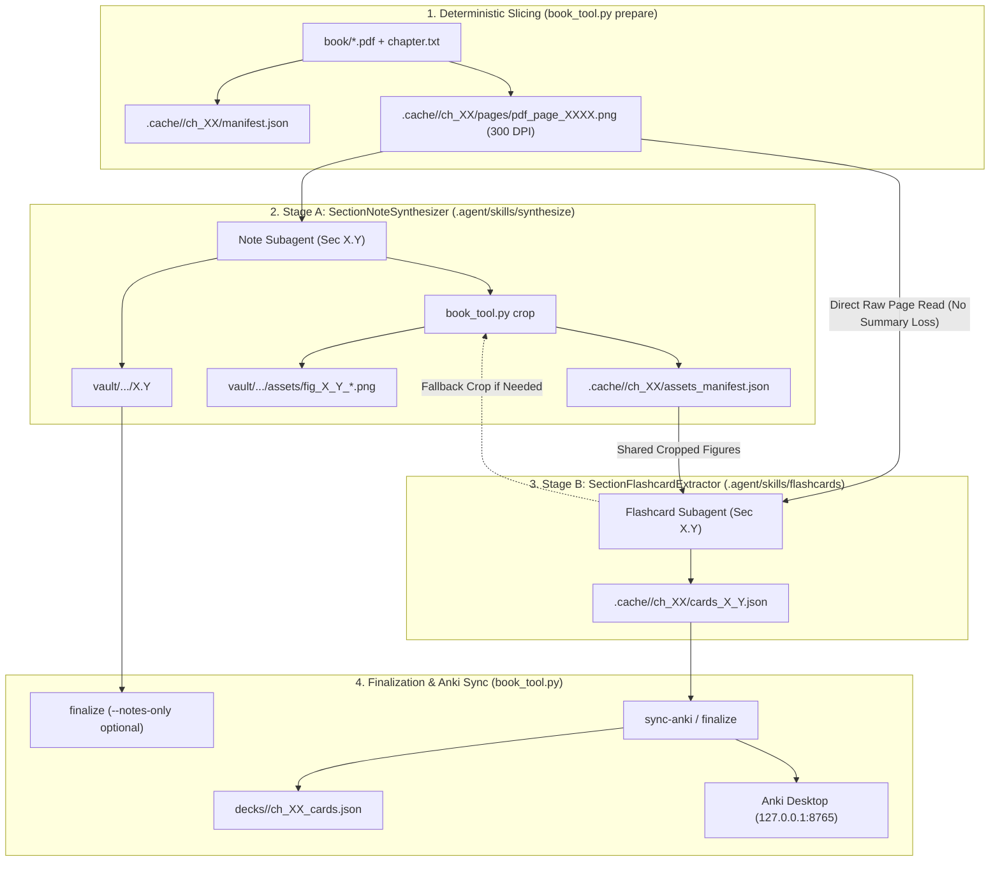

# Technical Specification: Decoupled Book-Synthesizer & Exhaustive Flashcard Engine

- **Status**: `FINAL — Red-Team Validated`
- **Last Updated**: 2026-10-22
- **Companion Audit Log**: [RED_TEAM_AUDIT.md](./RED_TEAM_AUDIT.md)

---

## 1. Overview & Core Problem

- **Core Problem Statement**: Studying dense engineering and mathematics textbooks follows a three-stage cognitive lifecycle:
  1. **Priming (Obsidian Notes)**: Building geometric, physical, and structural intuition before tackling the chapter.
  2. **Deep Diving (The Textbook)**: Reading the unabridged textbook prose, derivations, and diagrams.
  3. **Long-Term Retention (Anki Flashcards)**: Retaining all concepts over months and years exclusively through spaced repetition reviews—without returning to the textbook.

  Previously, a single monolithic skill/subagent attempted to write the Obsidian primer note and extract Anki flashcards in the same pass. This created two structural problems:
  - **Lossy Summary Cascade & Attention Split**: Generating both in a single pass risked turning flashcards into a summary of a summary or suffering token-budget exhaustion at the end of long derivations.
  - **Coupled Prompt Tuning**: Fine-tuning flashcard pedagogy (e.g., Cloze density, atomic rules, question style) required modifying the monolithic skill and risked regressing note synthesis, and vice versa.

- **Architectural Solution**: **Pipelined Dual-Agent Decoupling with Direct-from-Source Extraction**
  1. **Agent 1 — `SectionNoteSynthesizer` ([`.agent/skills/synthesize/SKILL.md`](./.agent/skills/synthesize/SKILL.md))**:
     - Reads the 300-DPI textbook page PNGs for section $X.Y$.
     - Crops all textbook figures, block diagrams, and plots into `vault/.../assets/fig_<X>_<Y>_<slug>.png` via `book_tool.py crop` (which logs them in `.cache/.../assets_manifest.json`).
     - Writes a distraction-free Obsidian Pre-Reading Primer Note (`X.Y <Title>.md`). Never generates flashcards.
  2. **Agent 2 — `SectionFlashcardExtractor` ([`.agent/skills/flashcards/SKILL.md`](./.agent/skills/flashcards/SKILL.md))**:
     - Runs as an independent, isolated agent stage with its own dedicated skill file so its prompt can be tuned freely without affecting note synthesis.
     - **Reads the raw 300-DPI textbook page PNGs directly** (never summarizing the primer note) so zero textbook notions are lost.
     - Consumes the already-cropped figures from `assets_manifest.json` (and can call `book_tool.py crop` as a fallback if it spots an uncropped figure worth testing).
     - Enforces the **5-Pillar Extraction Taxonomy** and the **Minimum Information Principle** to achieve 100% conceptual coverage without trivial semantic bloat.

- **Target Surface**: Local Windows environment running inside Antigravity, combining [`book_tool.py`](./book_tool.py) (deterministic PDF/Vault/Anki CLI helper), Obsidian (`vault/`), and desktop Anki via AnkiConnect (`http://127.0.0.1:8765`).

- **Non-Goals**:
  - Generating flashcards by summarizing the Obsidian note (cards must always read the raw 300-DPI textbook pages).
  - Hard-deleting cards on re-runs (orphaned cards are tagged `book_synthesizer::orphaned` and auto-suspended in Anki to preserve spaced repetition history).
  - External paid LLM API keys or cloud services.

---

## 2. Core User Flows (The Happy Path)

### Flow 1 — Full End-to-End Chapter Synthesis (`/synthesize`)
1. **Prepare**: `python book_tool.py prepare` slices the target chapter from `./chapter.txt` and `./book/*.pdf`, renders 300-DPI page PNGs, and outputs `manifest.json`.
2. **Stage A — Note Synthesis (`SectionNoteSynthesizer`)**:
   - Parallel section subagents read `pdf_page_XXXX.png` for each section $X.Y$, crop figures via `python book_tool.py crop` (populating `assets_manifest.json`), and write `vault/<Book>/Chapter XX/X.Y <Title>.md`.
3. **Stage B — Exhaustive Flashcard Extraction (`SectionFlashcardExtractor`)**:
   - Parallel flashcard subagents (following `.agent/skills/flashcards/SKILL.md`) read the raw `pdf_page_XXXX.png` images for section $X.Y$ alongside the cropped `section_assets` list, and extract exhaustive atomic cards across the 5-Pillar Taxonomy into `.cache/<book_slug>/ch_<XX>/cards_<X>_<Y>.json`.
4. **Finalize & Sync**:
   - Single-threaded `python book_tool.py finalize` sanitizes MathJax, injects `[[Prev]] | [[MOC]] | [[Next]]` links, builds `00 - Chapter XX MOC.md`, aggregates all section cards into `decks/<book_slug>/ch_<XX>_cards.json`, and syncs non-destructively to Anki via AnkiConnect.

### Flow 2 — Standalone Flashcard Generation, Refresh, or Prompt Tuning (`/flashcards`)
1. User edits `.agent/skills/flashcards/SKILL.md` (or gives custom instructions in chat) and triggers `/flashcards` (or asks to refresh/regenerate cards for a chapter or section).
2. `python book_tool.py refresh-cards [--chapter X] [--section X.Y]` inspects the chapter manifest, returns the exact 300-DPI `page_pngs`, `section_assets`, and `existing_cards` ledger for each section.
3. `SectionFlashcardExtractor` reads the raw 300-DPI textbook page PNGs directly, preserves card `id`s when refining existing concepts, crops any missing diagram if needed via `book_tool.py crop`, and writes `.cache/<book_slug>/ch_<XX>/cards_<X>_<Y>.json`.
4. `python book_tool.py sync-anki [--chapter X] [--section X.Y]` updates Anki in-place via `updateNoteFields` and suspends retired cards—without ever touching the Obsidian `.md` notes.

### Flow 3 — Standalone Note Synthesis Tuning (`/synthesize notes-only`)
1. User tunes `.agent/skills/synthesize/SKILL.md` and asks to regenerate or polish the Obsidian primer notes without touching Anki flashcards.
2. `SectionNoteSynthesizer` updates `vault/<Book>/Chapter XX/X.Y <Title>.md`.
3. `python book_tool.py finalize --notes-only` sanitizes MathJax and updates the MOC and navigation headers while skipping Anki aggregation and synchronization.

---

## 3. System Architecture & Components



### The 5-Pillar Flashcard Extraction Taxonomy
To satisfy the user's requirement that **nothing in the textbook feels new after studying the deck** while preventing trivial filler cards, `SectionFlashcardExtractor` systematically sweeps every paragraph, equation, and figure across 5 mandatory pillars:
1. **Pillar 1 — Formal Definitions & Nomenclature**: Exact definitions of every system property, signal class, operator, and symbol introduced in the text.
2. **Pillar 2 — Governing Equations, Derivations & Structure (`Cloze`)**: Every numbered and unnumbered equation, matrix structure, regressor vector, and key algebraic transition step, using atomic `{{c1::...}}` clozes.
3. **Pillar 3 — Explicit & Implicit Assumptions / Boundary Conditions**: When does a formula hold? What noise, linearity, stationarity, or invertibility (e.g., persistency of excitation) conditions are required? What breaks if violated?
4. **Pillar 4 — Physical, Geometric & Engineering Intuition (`Basic`)**: Why is the model structured this way? What is the physical meaning of each term or parameter in real-world engineering systems?
5. **Pillar 5 — Visual Diagram & Plot Interpretation (`Basic` / `Cloze` with Media)**: Signal flows, block diagrams, experimental plots, and geometric interpretations, embedding cropped `![[assets/fig_X_Y_<slug>.png]]` directly on the card.

---

## 4. Data Model & State Lifecycle

### Shared Asset Manifest (`.cache/<book_slug>/ch_<XX>/assets_manifest.json`)
Written automatically by `python book_tool.py crop`:
```json
{
  "assets": [
    {
      "filename": "fig_1_3_arx_block.png",
      "section": "1.3",
      "obsidian_embed": "![[assets/fig_1_3_arx_block.png]]",
      "source_pdf_page": 31,
      "bbox": "180,140,420,860",
      "cropped_image_path": "C:/.../vault/.../assets/fig_1_3_arx_block.png"
    }
  ]
}
```

### Section Flashcards Scratch File (`.cache/<book_slug>/ch_<XX>/cards_<X>_<Y>.json`)
```json
{
  "section": "1.3",
  "section_title": "An Archetypical Problem - ARX Models and the Linear Least Squares Method",
  "cards": [
    {
      "id": "ch01_s1_3_c01",
      "model": "Cloze",
      "pillar": "equations",
      "front": "In the ARX model structure $A(q)y(t) = B(q)u(t) + e(t)$, the linear regression predictor is written as {{c1::$\\hat{y}(t|\\theta) = \\varphi^T(t)\\theta$}}.",
      "back": "Here $\\varphi(t)$ is the regression vector of past outputs and inputs, and $\\theta$ is the parameter vector.",
      "tags": ["arx", "linear-regression", "pillar-equations"],
      "media": []
    }
  ]
}
```

---

## 5. Constraints, Edge Cases & Failure Modes

- **Single-Cloze Group Normalization**: `book_tool.py` automatically normalizes any `{{c2::...}}`, `{{c3::...}}` into `{{c1::...}}` and hoists clozes outside `\(...\)` so 1 JSON card always produces 1 atomic Anki review card with valid DOM preview.
- **Fallback Figure Cropping in Flashcard Stage**: If `SectionFlashcardExtractor` spots a textbook plot or schematic on `pdf_page_XXXX.png` that is not yet in `assets_manifest.json`, it runs `python book_tool.py crop` directly so visual cards never lack media.
- **Offline Tolerance**: If Anki Desktop is closed during `finalize` or `sync-anki`, cards are staged in `decks/<book_slug>/ch_<XX>_cards.json` with `synced: false` and pushed on the next `python book_tool.py sync-anki`.

---

## 6. Implementation Roadmap

- [x] **Milestone 1**: Validate decoupled architecture via Red-Team / Blue-Team debate and user cross-examination.
- [x] **Milestone 2**: Enhance `book_tool.py` (`crop` writes `assets_manifest.json`, `refresh-cards` exposes raw `page_pngs` + `section_assets` per section, `finalize` supports `--notes-only`).
- [x] **Milestone 3**: Create dedicated `.agent/skills/flashcards/SKILL.md` for `SectionFlashcardExtractor` and update `.agent/skills/synthesize/SKILL.md` for `SectionNoteSynthesizer` + pipelined orchestration.
